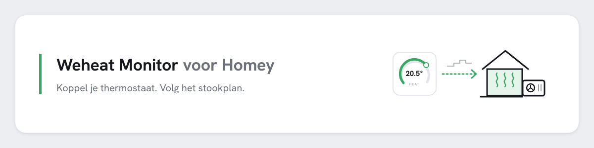

<picture>
  <source media="(prefers-color-scheme: dark)" srcset="docs/readme-banner-dark.png">
  
</picture>

# Weheat Monitor voor Homey

Een HomeyScript dat je thermostaat in Homey koppelt aan [weheat-monitor.nl](https://www.weheat-monitor.nl). Het is de Homey-tegenhanger van de [Home Assistant-integratie](https://github.com/kirvis13/weheat-monitor-ha).

- **Meten**: elke minuut de kamertemperatuur en het setpoint van je thermostaat, en welk type thermostaat het is (de Homey-app en de driver, nooit de naam).
- **Plan volgen** (optioneel, staat uit): het setpoint van het blok dat nu geldt gaat naar de thermostaat, altijd tussen 12 en 24 °C. Zo werkt ook de thermostaattest van de site.
- **Werkt bij een storing door**: metingen wachten tot 24 uur, het plan voor de komende 48 uur staat lokaal.
- Praat alleen met weheat-monitor.nl, nooit met Weheat zelf.

> English: a HomeyScript that connects a thermostat in Homey to weheat-monitor.nl. It sends room temperature and setpoint every minute and can let the thermostat follow the site's plan. Settings go in the flow argument (`key;thermostat name`), so updating means replacing the whole script. Homey Pro only.

## Wat je nodig hebt

- Een **Homey Pro** met de app **HomeyScript**. Op Homey Cloud bestaat HomeyScript niet.
- Een account op weheat-monitor.nl.
- Een thermostaat in Homey met een ingestelde temperatuur (`target_temperature`), bijvoorbeeld een Toon, Tado, Honeywell of Netatmo.

## Installeren

1. **Sleutel maken.** Ga naar [weheat-monitor.nl/settings/connections](https://www.weheat-monitor.nl/settings/connections), maak een nieuwe koppeling en kopieer de sleutel (`whm_` plus 64 tekens). Je ziet hem maar één keer.
2. **Script plakken.** Open HomeyScript op [my.homey.app](https://my.homey.app), maak een nieuw script met de naam `weheat-monitor` en plak de hele inhoud van [`weheat-monitor.js`](weheat-monitor.js) erin. Je hoeft er niets in aan te passen.
3. **Eerst controleren.** Maak een tweede script, `weheat-monitor-controle`, plak [`controle.js`](controle.js) erin, zet je sleutel bovenin en druk op **Test**. Je ziet dan zoiets als:
   ```
   OK    Sleutel geaccepteerd door weheat-monitor.nl. Plan voor deze koppeling: uit.
   OK    Thermostaat "Toon" (nl.toonwater.toonwater): setpoint 17 °C, kamer 22.3 °C.
   OK    HomeyScript kan de toestand bewaren.

   Alles in orde. Zet dit als argument in de flow:
   <je sleutel>;Toon
   ```
   Staat er een `FOUT`, dan zegt die regel wat er mis is. Het controlescript verandert niets aan je thermostaat; daarna mag je het weggooien.
4. **Flow maken.**
   - **Als**: Datum en tijd, elke 1 minuut.
   - **Dan**: HomeyScript, het script uitvoeren **met argument**. Kies `weheat-monitor` en zet als argument je sleutel, een puntkomma en de naam van je thermostaat zoals hij in Homey heet:
     ```
     whm_0123...;Toon
     ```
5. **Testen.** Druk in de flow op Testen. Na een minuut staat in de testtekst iets als `v0.2.0: plan volgen staat uit; wachtrij 0`. Op weheat-monitor.nl/settings/connections loopt "laatst gezien" mee.

## Het argument

Het argument is je sleutel en de naam van je thermostaat, met puntkomma's ertussen. Daarachter kun je opties zetten:

| Argument | Betekent |
|---|---|
| `whm_...;Toon` | Alleen meten |
| `whm_...;Toon;volg` | Ook het plan en de thermostaattest volgen (zie hieronder) |
| `whm_...;Toon;kamer=Woonkamer sensor` | De kamertemperatuur uit een losse sensor, als die beter hangt dan de thermostaat |
| `whm_...;Toon;tset=OTGW/target_temperature` | De gevraagde aanvoertemperatuur van een OpenTherm Gateway (`apparaat/capability`) |

Opties mogen samen: `whm_...;Toon;volg;kamer=Woonkamer sensor`. Een naam mag spaties bevatten, maar moet precies zo heten als in Homey.

**Welke capability heeft mijn OTGW?** Draai dit in een los HomeyScript, met de naam van je gateway:

```js
const d = Object.values(await Homey.devices.getDevices()).find((x) => x.name === "OTGW");
return Object.keys(d.capabilitiesObj);
```

## Plan volgen en de thermostaattest

Met `volg` in het argument mag de site het setpoint van je thermostaat zetten. Het script schrijft alleen als ook op de site het plan voor deze koppeling aan staat.

- **Jij wint.** Verandert het setpoint zonder dat het script het deed (jij, het schema van de thermostaat of een andere flow), dan stuurt het script vier uur niet en krijgt de site een seintje.
- **Geen plan meer**: één keer terug naar het basissetpoint, daarna blijft de thermostaat met rust.
- **Nooit buiten 12 tot 24 °C**, en altijd afgerond op de stap van je thermostaat.
- **Stoppen**: haal `volg` uit het argument, of zet de flow uit.

## Wat er naar de site gaat

| Wat | Waar het vandaan komt | Hoe vaak |
|---|---|---|
| Kamertemperatuur | De thermostaat, of de sensor uit `kamer=` | Elke minuut |
| Setpoint | De thermostaat | Elke minuut |
| Handmatig verzet | Bij de eerste meting na een wijziging die niet van het script kwam | Als het gebeurt |
| Gevraagde aanvoertemperatuur | Alleen met `tset=` | Elke minuut |
| Type thermostaat | De Homey-app en de driver, stap, minimum en maximum. Geen naam, geen id | Bij de start, na een wijziging en eens per dag |

De sleutel gaat alleen mee in de `Authorization`-kop en komt nooit in een log of in de testtekst.

## Updaten

Vervang de hele inhoud van het script door de nieuwe [`weheat-monitor.js`](weheat-monitor.js). Je instellingen staan in de flow, dus die blijven staan. Welke versie je hebt, staat vooraan in de testtekst. Wat er per versie veranderde: [`CHANGELOG.md`](CHANGELOG.md).

## Als het niet werkt

Draai eerst [`controle.js`](controle.js) (stap 3 hierboven): dat controleert sleutel, thermostaat en opslag in één keer. Daarnaast zegt de testtekst van het script zelf wat er aan de hand is:

| Je ziet | Wat je doet |
|---|---|
| `Geen geldige sleutel` | Het script draait zonder argument, of de sleutel klopt niet. Start het vanuit de flow met argument, en kijk of de hele sleutel erin staat |
| `thermostaat "..." niet gevonden` | De naam in het argument wijkt af van de naam in Homey. Let op spaties en hoofdletters |
| `"..." heeft geen target_temperature` | Dat apparaat is geen thermostaat, of de app geeft de ingestelde temperatuur (nog) niet door |
| `fout: HTTP 401` of `weigert de sleutel` | De sleutel is ingetrokken of verkeerd. Maak een nieuwe koppeling |
| `fout: geen verbinding` | Even geen internet of de site was niet bereikbaar. De metingen wachten en gaan later mee |

Kom je er niet uit, open dan een [issue](https://github.com/kirvis13/weheat-monitor-homey/issues) en zet de testtekst of de uitvoer van `controle.js` erbij. Daar staat nooit je sleutel in.

## Verwijderen

Zet de flow uit of verwijder hem, trek de koppeling in op weheat-monitor.nl/settings/connections, en wis de bewaarde toestand met een los HomeyScript:

```js
global.set("weheat_monitor_toestand", null);
```

## Privacy

De sleutel gaat alleen mee in de `Authorization: Bearer`-kop, komt nooit in een log of testtekst en staat alleen in je flow. Alleen wat onder "Wat er naar de site gaat" staat verlaat je huis, en alleen naar weheat-monitor.nl. Trek de sleutel in op de site om alles in één keer te stoppen.

## Ontwikkelen

```bash
bun run test/script.test.ts
```

De test draait het echte script en `controle.js` zoals HomeyScript dat doet (zonder `AbortController`, instellingen in `args[0]`), tegen een nagebootste Homey en server. Hij dekt de wachtrij, de blokkeuze, de vier-uurregel, de grens van 12 tot 24 °C en dat bij het type thermostaat nooit naam of id meegaat.

Wil je helpen? Zie [CONTRIBUTING.md](CONTRIBUTING.md).

## Versies

Zie [CHANGELOG.md](CHANGELOG.md). Releases krijgen een tag `vX.Y.Z`, gelijk aan de versie bovenin `weheat-monitor.js`.

## Licentie

MIT
