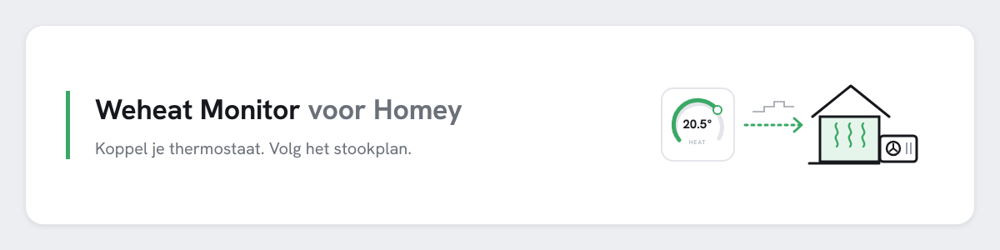

<picture>
  <source media="(prefers-color-scheme: dark)" srcset="docs/readme-banner-dark.png">
  
</picture>

# Weheat Monitor voor Homey

Een HomeyScript dat je thermostaat in Homey koppelt aan [weheat-monitor.nl](https://www.weheat-monitor.nl). Het is de Homey-tegenhanger van de [Home Assistant-integratie](https://github.com/kirvis13/weheat-monitor-ha).

- **Meten**: elke minuut de kamertemperatuur en het setpoint van je thermostaat, en welk type thermostaat het is (de Homey-app en de driver, nooit de naam).
- **Plan volgen** (optioneel, staat uit): het setpoint van het blok dat nu geldt gaat naar de thermostaat, altijd tussen 12 en 24 °C. Zo werkt ook de thermostaattest van de site.
- **Ruimtes** (optioneel): de temperatuursensoren in andere kamers, met vocht, CO2 en luchtdruk, elk als ruimte op de site. Alleen nieuwe waarden.
- **Werkt bij een storing door**: metingen wachten tot 24 uur, het plan voor de komende 48 uur staat lokaal.
- Praat alleen met weheat-monitor.nl, nooit met Weheat zelf.

> English: a HomeyScript that connects a thermostat in Homey to weheat-monitor.nl. It sends room temperature and setpoint every minute and can let the thermostat follow the site's plan. Settings go in the flow argument (`key;thermostat name`), so updating means replacing the whole script. Homey Pro only.

## Wat je nodig hebt

- Een **Homey Pro** met de app **HomeyScript**. Op Homey Cloud bestaat HomeyScript niet.
- Een account op weheat-monitor.nl.
- Een thermostaat in Homey met een ingestelde temperatuur (`target_temperature`), bijvoorbeeld een Toon, Tado, Honeywell of Netatmo.

## Installeren

1. **Sleutel maken.** Ga naar [weheat-monitor.nl/settings/connections](https://www.weheat-monitor.nl/settings/connections), maak een nieuwe koppeling en kopieer de sleutel (`whm_` plus 64 tekens). Je ziet hem maar één keer.
2. **Eerst controleren.** Open HomeyScript op [my.homey.app](https://my.homey.app), maak een script `weheat-monitor-controle` en plak [`controle.js`](controle.js) erin. Bovenin vul je in wat je weet:
   ```js
   const SLEUTEL = "whm_...";   // je sleutel uit stap 1
   const THERMOSTAAT = "";      // de thermostaat die je warmtepomp aanstuurt (leeg = de enige die er is)
   const KAMERSENSOR = "";      // optioneel: een losse thermometer die de kamer beter meet
   const VOLG_PLAN = false;     // true: de thermostaat volgt het plan van de site
   const RUIMTES = "";          // optioneel: "alle", of zones met komma's ("Slaapkamer achter,Zolder")
   ```
   Druk op **Test**. Weet je een naam nog niet, laat hem dan leeg: de uitvoer noemt alle thermostaten en thermometers in Homey. Kopieer de juiste naam, vul hem in en druk opnieuw op Test. Als alles klopt, zie je onder de knop zoiets als:
   ```
   Weheat Monitor: controle

   ✅ Sleutel geaccepteerd door weheat-monitor.nl. Plan voor deze koppeling: uit.
   ✅ Thermostaat "Toon" (nl.toonwater.toonwater): setpoint 17 °C, kamer 18.6 °C.
   ✅ Kamersensor "Woonkamer": 21.8 °C.
   ✅ HomeyScript kan de toestand bewaren.

   Thermostaten in Homey (voor THERMOSTAAT):
     • "Toon": setpoint 17 °C
     • "Werkkamer": setpoint 19 °C

   Thermometers in Homey (voor KAMERSENSOR, optioneel):
     • "Sensor hal": 19.4 °C
     • "Woonkamer": 21.8 °C

   Alles in orde. Zo bouw je de flow:
     • Als: Datum en tijd, Elke 1 minuut
     • Dan: HomeyScript, Voer een script uit met argument
     • Script: weheat-monitor
     • Argument: kopieer de regel hieronder

   whm_0123...;Toon;kamer=Woonkamer
   ```
   Staat er een ❌, dan zegt die regel wat er mis is; het flowblok komt pas als alles goed is. Staat er bij een naam "naam staat dubbel in Homey", geef dat apparaat in Homey dan eerst een eigen naam, anders weet het script niet welke je bedoelt. Het controlescript verandert niets aan je thermostaat. Bewaar het: draai het opnieuw als je later een andere thermostaat of thermometer wilt.
3. **Script plakken.** Maak een tweede script met de naam `weheat-monitor` en plak de hele inhoud van [`weheat-monitor.js`](weheat-monitor.js) erin. Je hoeft er niets in aan te passen: je sleutel en thermostaat komen in de flow. Sla het op, maar druk hier **niet** op Test. Zonder argument meldt het script `Geen geldige sleutel`; dat is in deze stap normaal.
4. **Flow maken.** Neem het flowblok uit stap 2 over:
   - **Als**: Datum en tijd, elke 1 minuut.
   - **Dan**: HomeyScript, "Voer een script uit met argument". Kies `weheat-monitor` en plak als argument de regel achter `Argument`.
5. **Testen.** Test nu via de flow, niet in het script: druk in de flow op **Testen**. Het script meldt zich in de **tijdlijn** van Homey:
   ```
   ✅ Weheat Monitor: verbonden met weheat-monitor.nl (kamer 18.6 °C, setpoint 17 °C). Vanaf nu elke minuut een meting.
   ```
   Klopt een naam in het argument niet, dan wordt de HomeyScript-kaart in de flow rood en zegt de foutmelding welke naam. Op weheat-monitor.nl/settings/connections loopt "laatst gezien" mee.

### Wat je in de tijdlijn ziet

Het script schrijft alleen in de tijdlijn als er iets verandert, nooit elke minuut:

| Melding | Wanneer |
|---|---|
| ✅ verbonden met weheat-monitor.nl | De eerste keer dat het lukt |
| ⚠️ niet bereikbaar sinds ... | De site is een kwartier niet bereikbaar. De metingen wachten tot 24 uur |
| ✅ weer verbonden | Na zo'n storing, als de bewaarde metingen verstuurd zijn |
| ❌ weigert de sleutel | Meteen, als de sleutel is ingetrokken of niet klopt |
| ⚠️ thermostaat of kamersensor niet gevonden | Eén keer, als een naam in het argument niet (meer) klopt |
| ⚠️ al twee uur geen nieuwe temperatuur van ... | Eén keer per sensor uit `ruimtes=`, als die twee uur stil is (lege batterij, buiten bereik) |

## Het argument

Het argument is je sleutel en de naam van je thermostaat, met puntkomma's ertussen. Daarachter kun je opties zetten:

| Argument | Betekent |
|---|---|
| `whm_...;Toon` | Alleen meten |
| `whm_...;Toon;volg` | Ook het plan en de thermostaattest volgen (zie hieronder) |
| `whm_...;Toon;kamer=Woonkamer sensor` | De kamertemperatuur uit een losse sensor, als die beter hangt dan de thermostaat |
| `whm_...;Toon;tset=OTGW/target_temperature` | De gevraagde aanvoertemperatuur van een OpenTherm Gateway (`apparaat/capability`) |
| `whm_...;Toon;ruimtes=alle` | Ook de temperatuursensoren in andere ruimtes (zie [Ruimtes](#ruimtes)) |
| `whm_...;Toon;ruimtes=Slaapkamer achter,Zolder` | Alleen de sensoren in die zones |

Opties mogen samen: `whm_...;Toon;volg;kamer=Woonkamer sensor`. Een naam mag spaties bevatten, maar moet precies zo heten als in Homey.

### Hoe heet mijn thermostaat of sensor?

Het script zoekt apparaten op hun naam in Homey, precies zoals die er staat: hoofdletters en spaties tellen mee.

- **Makkelijkst**: draai [`controle.js`](controle.js) (stap 2) met `THERMOSTAAT` en `KAMERSENSOR` leeg. Het noemt elke thermostaat (alles met een ingestelde temperatuur) en elke losse thermometer bij naam, met wat hij nu meet. Kopieer de naam van daaruit, vul hem in en druk opnieuw op Test.
- **In de Homey-app**: Apparaten, tik op het apparaat, het tandwiel. Bovenaan staat de naam. Daar kun je hem ook veranderen in iets korts zonder rare tekens, bijvoorbeeld `Thermometer woonkamer`. Verander je de naam later, pas dan ook het argument in de flow aan.

Als kamersensor werkt elk apparaat dat een temperatuur meet (`measure_temperature`): een Aqara-, Netatmo- of Shelly-thermometer, een bewegingsmelder met temperatuur, enzovoort. Hang hem waar je echt zit, niet in de zon of bij de radiator. Vindt het script de sensor niet, of geeft hij geen temperatuur, dan gebruikt het de kamertemperatuur van de thermostaat en zegt dat één keer in de tijdlijn.

**Welke capability heeft mijn OTGW?** Draai dit in een los HomeyScript, met de naam van je gateway:

```js
const d = Object.values(await Homey.devices.getDevices()).find((x) => x.name === "OTGW");
return Object.keys(d.capabilitiesObj);
```

## Ruimtes

Met `ruimtes=` gaan ook de temperatuursensoren in andere kamers naar de site, elk als een ruimte. Zo ziet de site of de slaapkamers op hun doel komen, en later hoe je huis per kamer afkoelt.

- **Welke sensoren**: elk apparaat met een temperatuur (`measure_temperature`) in de zones die je noemt, of in alle zones met `ruimtes=alle`. Een zone telt ook voor de zones erin, dus `ruimtes=Eerste verdieping` neemt alle kamers op die verdieping mee. Hooguit 20.
- **Nooit**: een thermostaat of radiatorkraan (alles met een ingestelde temperatuur; je thermostaat gaat al mee), en nooit buiten: niet in een zone Buiten, Tuin, Terras, Balkon (of Outside, Outdoor, Garden), en geen apparaat waarvan de naam met "Buiten" begint.
- **Naam**: de zone, met de zone erboven als verdieping. Welke kamer het op de site echt is, het doel en of hij meetelt, stel je in op weheat-monitor.nl bij Instellingen, Koppelingen. Een nieuwe naam in Homey maakt geen nieuwe ruimte: de site herkent de sensor aan een hash van zijn id.
- **Vocht, CO2 en luchtdruk**: van hetzelfde apparaat, anders van de enige sensor van die soort in dezelfde zone. Twee in de zone en geen op het apparaat: geen, want een verkeerde sensor is erger dan geen waarde. Luchtdruk geeft Homey in mbar; dat is gelijk aan hPa.
- **Alleen nieuwe waarden**: een meting gaat mee als een van de waarden veranderde, met het tijdstip van die verandering. Nooit een herhaling.
- **Stil**: geeft een sensor twee uur geen nieuwe temperatuur, dan staat dat één keer in de tijdlijn.
- **Stoppen**: haal `ruimtes=` uit het argument. Wat nog wachtte, vervalt dan.

`controle.js` laat per zone zien welke sensoren er zijn en, met `RUIMTES` ingevuld, precies wat er meegaat:

```
✅ Ruimtes: 3 sensoren gaan mee naar weheat-monitor.nl:
    Kinderkamer (Eerste verdieping): 19.4 °C, 56 %  [Shelly H&T]
    Slaapkamer achter (Eerste verdieping): 17.2 °C, 63 %, 640 ppm, 1013.2 hPa  [Aqara slaapkamer]
    Woonkamer (Begane grond): 21.8 °C  [Woonkamer sensor]
```

## Plan volgen en de thermostaattest

Met `volg` in het argument mag de site het setpoint van je thermostaat zetten. Het script schrijft alleen als ook op de site het plan voor deze koppeling aan staat.

- **Jij wint.** Verandert het setpoint zonder dat het script het deed (jij, het schema van de thermostaat of een andere flow), dan stuurt het script vier uur niet en krijgt de site een seintje.
- **Geen plan meer**: één keer terug naar het basissetpoint, daarna blijft de thermostaat met rust.
- **Nooit buiten 12 tot 24 °C**, en altijd afgerond op de stap van je thermostaat.
- **Stoppen**: haal `volg` uit het argument, of zet de flow uit.

## Wat er naar de site gaat

| Wat | Waar het vandaan komt | Hoe vaak |
|---|---|---|
| Kamertemperatuur | De thermostaat, of de sensor uit `kamer=` | Elke minuut |
| Setpoint | De thermostaat | Elke minuut |
| Handmatig verzet | Bij de eerste meting na een wijziging die niet van het script kwam | Als het gebeurt |
| Gevraagde aanvoertemperatuur | Alleen met `tset=` | Elke minuut |
| Type thermostaat | De Homey-app en de driver, stap, minimum en maximum. Geen naam, geen id | Bij de start, na een wijziging en eens per dag |
| Ruimtes (alleen met `ruimtes=`) | Per sensor: een sleutel (een hash van het id van het apparaat), de naam van de zone, de zone erboven, en een meting met temperatuur en, als die er is, vocht, CO2 (ppm) en luchtdruk (hPa), op het tijdstip dat de sensor veranderde | Een meting alleen als een waarde veranderde; naam en zone elke minuut |

De sleutel gaat alleen mee in de `Authorization`-kop en komt nooit in een log, een foutmelding of de tijdlijn.

## Updaten

Vervang de hele inhoud van het script door de nieuwe [`weheat-monitor.js`](weheat-monitor.js). Je instellingen staan in de flow, dus die blijven staan. Welke versie je hebt, staat bovenin het script (`const VERSIE`). Wat er per versie veranderde: [`CHANGELOG.md`](CHANGELOG.md).

## Als het niet werkt

Draai eerst [`controle.js`](controle.js) (stap 2 hierboven): dat controleert sleutel, thermostaat, opslag en tijdlijn in één keer. Daarnaast zeggen de tijdlijn en een rode HomeyScript-kaart in de flow wat er aan de hand is:

| Je ziet | Wat je doet |
|---|---|
| `Geen geldige sleutel` | Het script draait zonder argument (bijvoorbeeld met Test in HomeyScript zelf), of de sleutel klopt niet. Test via de flow met argument, en kijk of de hele sleutel erin staat |
| `thermostaat "..." niet gevonden` | De naam in het argument wijkt af van de naam in Homey. Let op spaties en hoofdletters |
| `zone "..." uit ruimtes= niet gevonden` | De zone na `ruimtes=` heet anders in Homey. `controle.js` noemt alle zones met een temperatuursensor |
| `kamersensor "..." niet gevonden` | De naam na `kamer=` wijkt af van de naam in Homey. Het script gebruikt zolang de kamertemperatuur van de thermostaat |
| `"..." heeft geen ingestelde temperatuur` | Dat apparaat is geen thermostaat, of de app geeft de ingestelde temperatuur (nog) niet door |
| `weigert de sleutel` | De sleutel is ingetrokken of verkeerd. Maak een nieuwe koppeling |
| `niet bereikbaar sinds ...` | Geen internet, of de site was niet bereikbaar. De metingen wachten en gaan later mee; je krijgt "weer verbonden" als het weer lukt |
| Niets in de tijdlijn, kaart niet rood | Kijk of de flow aan staat. Meldde `controle.js` dat HomeyScript niet in de tijdlijn kan schrijven, dan werkt het script wel, maar zonder meldingen. Kijk dan op weheat-monitor.nl/settings/connections bij "laatst gezien" |

Kom je er niet uit, open dan een [issue](https://github.com/kirvis13/weheat-monitor-homey/issues) en zet de melding uit de tijdlijn of de uitvoer van `controle.js` erbij. In de tijdlijn staat nooit je sleutel; haal bij de uitvoer van `controle.js` de regel `Argument` weg, want daar staat hij wel in.

## Verwijderen

Zet de flow uit of verwijder hem, trek de koppeling in op weheat-monitor.nl/settings/connections, en wis de bewaarde toestand met een los HomeyScript:

```js
global.set("weheat_monitor_toestand", null);
```

## Privacy

De sleutel gaat alleen mee in de `Authorization: Bearer`-kop, komt nooit in een log, foutmelding of de tijdlijn en staat alleen in je flow en in het controlescript. Alleen wat onder "Wat er naar de site gaat" staat verlaat je huis, en alleen naar weheat-monitor.nl. Trek de sleutel in op de site om alles in één keer te stoppen.

## Ontwikkelen

```bash
bun run test/script.test.ts
```

De test draait het echte script en `controle.js` zoals HomeyScript dat doet (zonder `AbortController`, instellingen in `args[0]`), tegen een nagebootste Homey en server. Hij dekt de wachtrij, de blokkeuze, de vier-uurregel, de grens van 12 tot 24 °C, dat bij het type thermostaat nooit naam of id meegaat, en de ruimtes: welke sensoren, buiten, vocht en CO2 erbij, alleen nieuwe waarden, een site die `rooms` nog niet kent. Het blok dat de ruimtes kiest staat in beide scripts en moet gelijk blijven; de test bewaakt dat.

Wil je helpen? Zie [CONTRIBUTING.md](CONTRIBUTING.md).

## Versies

Zie [CHANGELOG.md](CHANGELOG.md). Releases krijgen een tag `vX.Y.Z`, gelijk aan de versie bovenin `weheat-monitor.js`.

## Licentie

MIT
